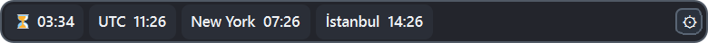
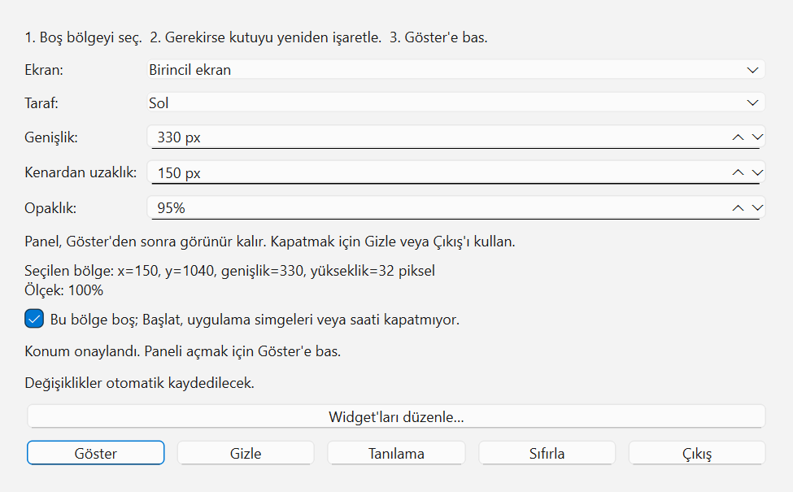
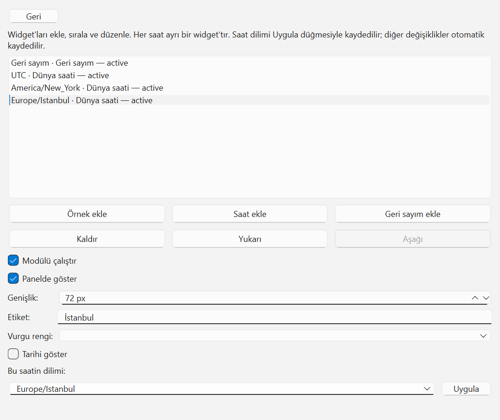
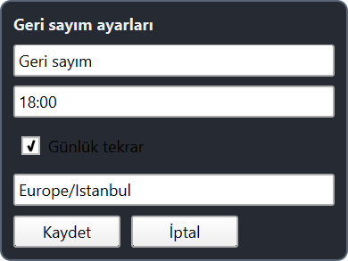

# w11widget

**w11widget 0.6.2**, Windows 11 kullanan 64 bit (x64) bilgisayarlar için geliştirilen bir görev çubuğu panelidir. Farklı şehirlerin saatlerini ve belirlediğiniz bir saate kalan süreyi küçük bir alanda birlikte görmenizi sağlar. Saatler ve geri sayımlar birbirinden bağımsız eklenir, adlandırılır, sıralanır ve gizlenir.



Görseller gerçek uygulama arayüzünden örnek ayarlarla alınmıştır. Ana görselde panel genişliği 520 piksel, yerleşim örneğinde 330 pikseldir; saatler, ekran ölçüleri ve tema bilgisayarınıza göre değişir.

## İndirme ve kurulum

Son sürümün [kurulum dosyasını indirin](https://github.com/mrvozdas/widgets/releases/download/v0.6.2/w11widget-0.6.2-installer.exe) veya [Releases](https://github.com/mrvozdas/widgets/releases) bölümünü açın. Dosya adı `w11widget-0.6.2-installer.exe` şeklindedir. İndirilen dosyanın bütünlüğünü sürüm açıklamasındaki SHA-256 değeriyle karşılaştırabilirsiniz. Kurulum dosyası dijital olarak imzalanmamıştır.

1. Releases bölümünden kurulum dosyasını indirin ve çalıştırın.
2. Kurulum kullanıcı hesabınızın `%LOCALAPPDATA%\w11widget\app\` klasöründe ayrı bir uygulama klasörü oluşturur. Yönetici olarak çalıştırılması gerekmez.
3. Kurulum uygulamayı açar. Zaten çalışan bir kopya varsa onu kapatmaz; yeni uygulamanın hazırlandığı dosya yolunu gösterir. **Panel kontrolü → Çıkış** ile çalışan kopyadan çıktıktan sonra bu yoldaki `w11widget.exe` dosyasını açabilirsiniz.

Sonraki açılışlarda kurulum klasöründeki `w11widget.exe` dosyasını çalıştırın. Normal açılış, kayıtlı ayarlarla paneli göstermeyi dener. Aynı kullanıcı oturumunda tekrar normal açılış yapmak ikinci bir panel oluşturmaz.

Hedef işletim sistemi **Windows 11 x64**'tür. Temiz bir Windows kurulumu üzerindeki son kullanıcı doğrulaması henüz tamamlanmamıştır; diğer işletim sistemleri için uyumluluk beyanı yoktur.

## Paneli yerleştirme ve yönetme

Panelin sağındaki **dişli** düğmesi **Panel kontrolü** penceresini açar. Bu düğme, bütün saatleri gizleseniz veya kaldırsanız da kullanılabilir.



1. **Ekran** ve **Taraf** alanlarından panelin bulunacağı ekranı ve görev çubuğunun sol ya da sağ tarafını seçin.
2. **Genişlik** ve **Kenardan uzaklık** değerlerini ayarlayın. **Opaklık** ile panelin saydamlığını değiştirebilirsiniz.
3. Seçtiğiniz alanın Başlat düğmesini, uygulama simgelerini veya sistem saatini kapatmadığını kontrol edin. **Bu bölge boş; Başlat, uygulama simgeleri veya saati kapatmıyor.** kutusunu işaretleyin.
4. **Göster** düğmesine basın. Konumu değiştirirseniz yeni alanı yeniden onaylayıp **Göster** düğmesine basın; açık panel yeni konum uygulanana kadar önceki yerinde kalır.

| Denetim | İşlev |
|---|---|
| **Göster** | Onayladığınız konumda paneli gösterir. |
| **Gizle** | Paneli gizler; kontrol penceresi üzerinden tekrar gösterebilirsiniz. |
| **Widget'ları düzenle…** | Saatleri, geri sayımları ve diğer panel öğelerini yönetir. |
| **Tanılama** | Konum ve uygulama durumuyla ilgili bilgileri, ayar dosyasının yoluyla birlikte gösterir. |
| **Sıfırla** | Paneli gizler; panel ve widget ayarlarını varsayılana döndürür. Konumu yeniden onaylamak gerekir. |
| **Çıkış** | Uygulamayı tamamen kapatır. |

Panel görünürken kontrol penceresini kapatmak paneli kapatmaz. Panel görünmüyorken kontrol penceresini kapatmak uygulamadan çıkar. Uygulama sistem tepsisi simgesi oluşturmaz.

Panel veya ayarlar görünmüyorsa, kurulum klasöründe şu komutla **Panel kontrolü** penceresini açabilirsiniz:

```text
w11widget.exe --settings
```

Çalışan bir kopya varsa bu komut onun kontrol penceresini açar ve panelin mevcut durumunu korur. Uygulama bu komutla ilk kez açılıyorsa panel başlangıçta gizlidir; konumu onaylayıp **Göster** ile açın.

## Dünya saatleri

Varsayılan panelde UTC, New York ve İstanbul için ayrı saatler bulunur. Her saat tam 24 saatlik `HH:mm` biçimini kullanır. Panelde bir saate tıklamak o saatin tarih, saat ve saat dilimi ayrıntılarını gösterir.



1. Dişliye basın ve **Widget'ları düzenle…** bölümünü açın.
2. **Saat ekle** düğmesiyle yeni bir UTC saati ekleyin veya listeden mevcut bir saati seçin.
3. **Etiket** alanına panelde görünecek adı yazın. Enter'a bastığınızda veya alandan çıktığınızda ad kaydedilir. Adı temizlerseniz saat diliminin varsayılan adı geri gelir.
4. **Bu saatin dilimi** alanından bir saat dilimi seçin veya `Europe/Istanbul`, `America/New_York`, `Europe/London` gibi geçerli bir IANA adı yazın. Değişikliği kaydetmek için **Uygula** düğmesine basın. Geçersiz bir ad hata gösterir ve kayıtlı dilimi değiştirmez.
5. **Tarihi göster** kutusuyla yalnızca seçili saate ay-gün (`MM-dd`) bilgisini ekleyin.

Her saatin adı, saat dilimi ve tarih tercihi bağımsızdır. Saat dilimini değiştirmek özel olarak verdiğiniz adı korur. Saatlerin genişliği içeriklerine göre hesaplanır; saat seçiliyken **Genişlik** alanı bu nedenle kapalıdır.

## Geri sayım

Geri sayım, seçtiğiniz saat dilimindeki hedef saate kalan **saat ve dakikayı** gösterir. Varsayılan hedef `Europe/Istanbul` diliminde `18:00` ve günlük tekrardır.



1. **Widget'ları düzenle… → Geri sayım ekle** ile bir geri sayım ekleyin.
2. Paneldeki **kum saati / kalan süre** alanına tıklayın.
3. Adı, 24 saatlik `HH:mm` biçiminde hedef saati ve IANA saat dilimini girin.
4. Her gün aynı saatte tekrarlamasını istiyorsanız **Günlük tekrar** seçeneğini açık bırakın.
5. **Kaydet** ile uygulayın. Geri sayım hedef saate göre otomatik hesaplanır; **İptal** kaydetmeden kapatır.

Günlük tekrar açıkken hedefe ulaşıldığında bir dakika **Tamamlandı** görünür, ardından ertesi günün hedefi hesaplanır. Yeni bir geri sayımda günlük tekrarı kapatırsanız hedefin bir sonraki tarihi kaydedilir: saat henüz gelmediyse bugün, geçtiyse yarın. Tek seferlik hedef tamamlandığında **Tamamlandı** durumunda kalır. Yeni bir tek seferlik hedef için yeni geri sayım ekleyebilirsiniz.

## Widget listesini düzenleme

**Widget'ları düzenle…** bölümünde en fazla **16** öğe bulunabilir. Bir öğeyi seçip aşağıdaki denetimleri kullanın:

| Denetim | İşlev |
|---|---|
| **Modülü çalıştır** | Seçili öğeyi etkinleştirir veya devre dışı bırakır. |
| **Panelde göster** | Seçili öğenin paneldeki görünürlüğünü değiştirir. |
| **Yukarı / Aşağı** | Öğenin paneldeki sırasını değiştirir. |
| **Kaldır** | Seçili öğeyi listeden siler. |
| **Örnek ekle** | Etiketi, vurgu rengi ve genişliği düzenlenebilen örnek bir öğe ekler. |
| **Geri** | Panel kontrolüne döner. |

Saat dilimi için **Uygula**, geri sayımın açılır ayarları için **Kaydet** kullanılır; listedeki diğer değişiklikler otomatik kaydedilir. Saatler ve geri sayımlar içerik genişliğini kullanır. Öğeler panel genişliğine sığmazsa panelin içindeki satırı yatay kaydırabilirsiniz; dişli düğmesi sabit kalır.

## Ayarlar ve yerel çalışma

Tercihler kullanıcı hesabınızın `%LOCALAPPDATA%\w11widget\settings.json` dosyasında tutulur. Kesin dosya yolunu **Tanılama** penceresinden görebilirsiniz. Yeni bir kurulum ayrı uygulama klasörü oluşturur ve mevcut tercih dosyasını değiştirmez.

Dünya saatleri ve geri sayımlar bilgisayarın sistem saati ve yerel saat dilimi verileriyle çalışır; bu özellikler için hesap veya internet bağlantısı gerekmez. Bilgisayarın tarihi ya da saati yanlışsa paneldeki hesaplamalar da bundan etkilenir.

## Üçüncü taraf lisansları

Uygulama Qt 6.12 kütüphanelerini kullanır. LGPLv3 metinleri, üçüncü taraf bildirimleri ve ilgili Qt kütüphane kaynakları kurulum klasöründeki licenses bölümünde bulunur. Bu kaynaklar üçüncü taraf kütüphanelerine aittir; uygulamanın kendi kaynakları dağıtılmaz. Uygulamayı çalıştırmak için Python veya geliştirme araçları kurmanız gerekmez.
